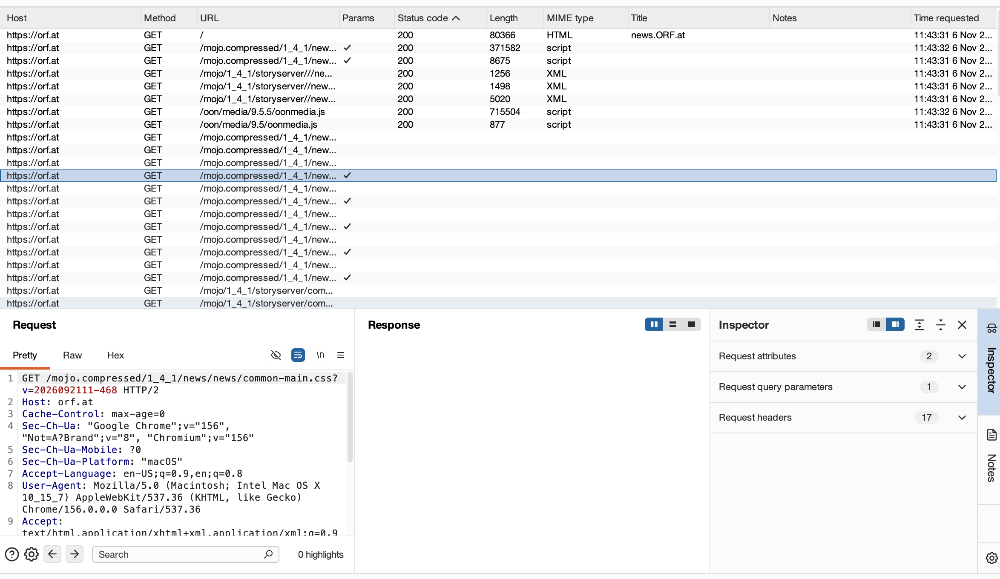
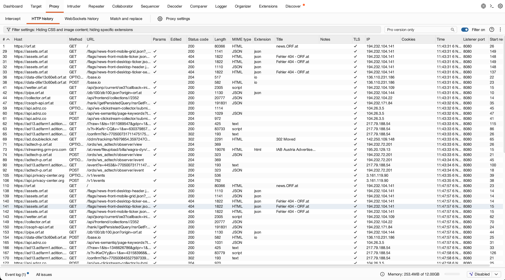
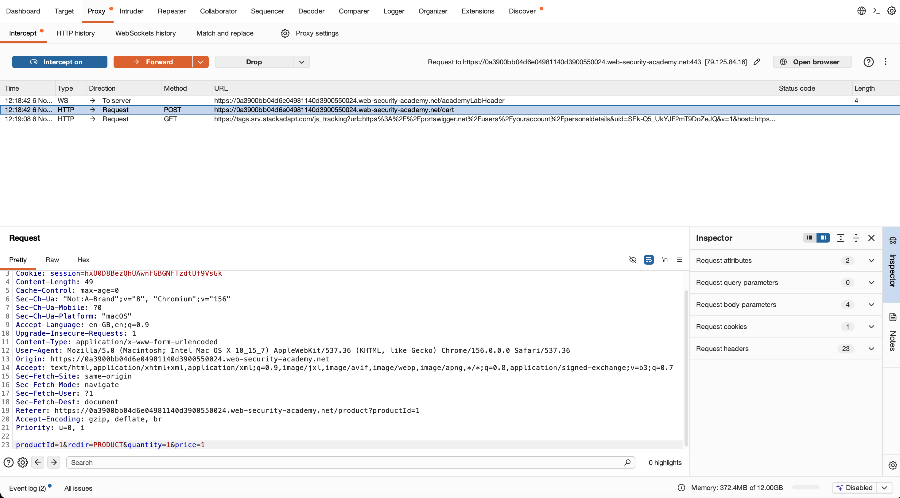
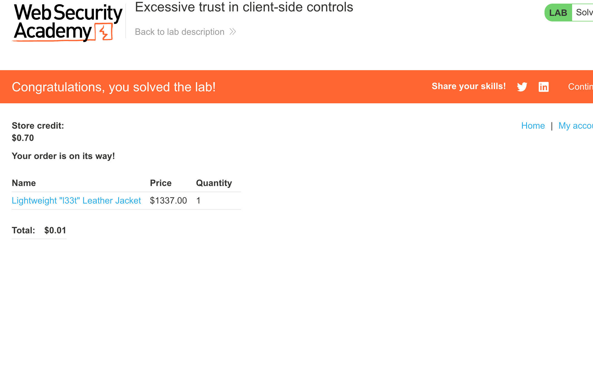

Datum: 06.11.2026       
Klassen: 5 AHITS      
Fach: ITSE5-Übungen      
Gruppe: Jonas Pichler und Lisa Hintermaier
Titel der Übungsblatts: Übung 3 - Burp Suite Intro         
Link: https://www.franzmatejka.at/htl/doc/ITSI_5/itsi5-lecture/04_burp.html         

# Übung 3.1 
Erledigt! 

# Übung 3.2 (Burp Suite Intro)    

Step 2:       
Vorab haben wir das Tool installiert und orf.at in dem Browser geöffnet, dieser fängt alle HTTP Anfragen ab.          
  
         

Weiter haben wir den Step2: Forward the request haben wir gemacht und den Step 2.5 angefügt:    

           

Step 2 erledigt!

Step 3:
Zuerst haben wir die angegebene Website aufgerufen und haben die Benutzerdaten Wiener und das Passwort Peter eingegeben.    
Dannach haben wir die Leather Jacket gesucht     
Bei der HTTP History haben wir unseren Reauest gefunden und den Preis geändert gefunden.      

Step 3 erledigt! 

Step 4: 
Wir haben und auf der Fake shopping Website angemeldet und die # Anordnung vom höchsten zum niedrigsten gestellt
stecken: 4.4